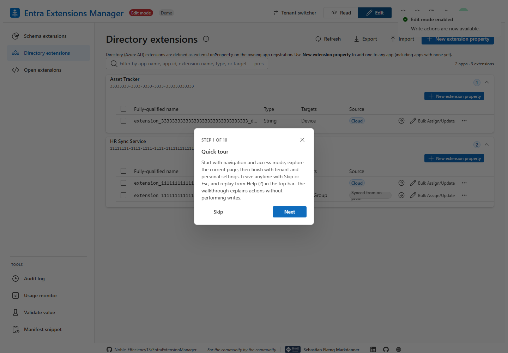
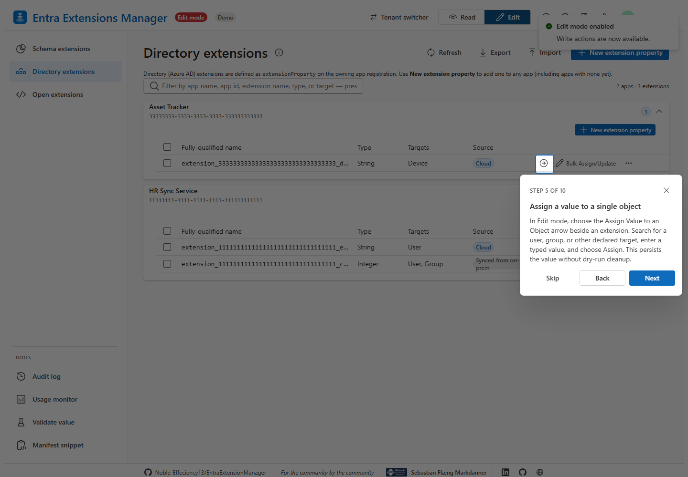
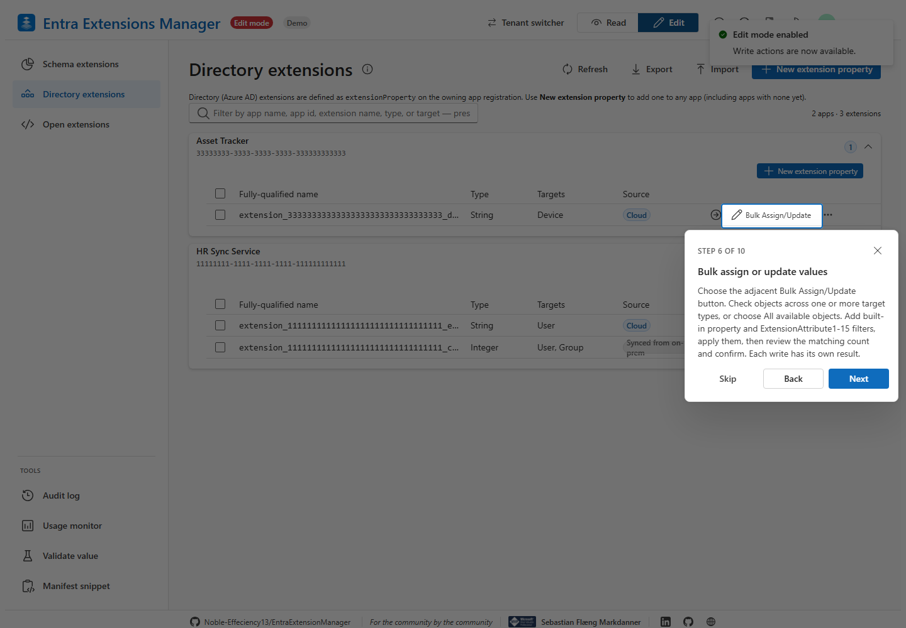
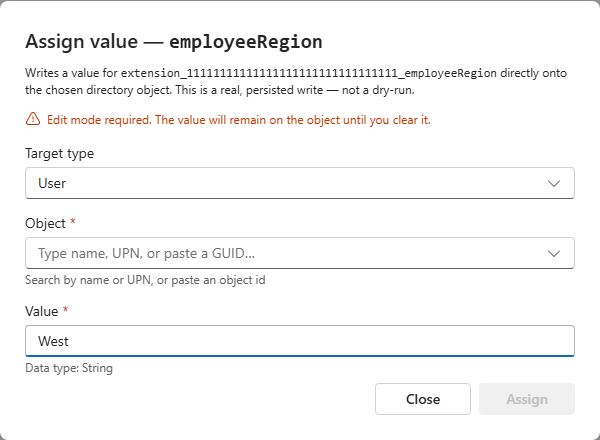
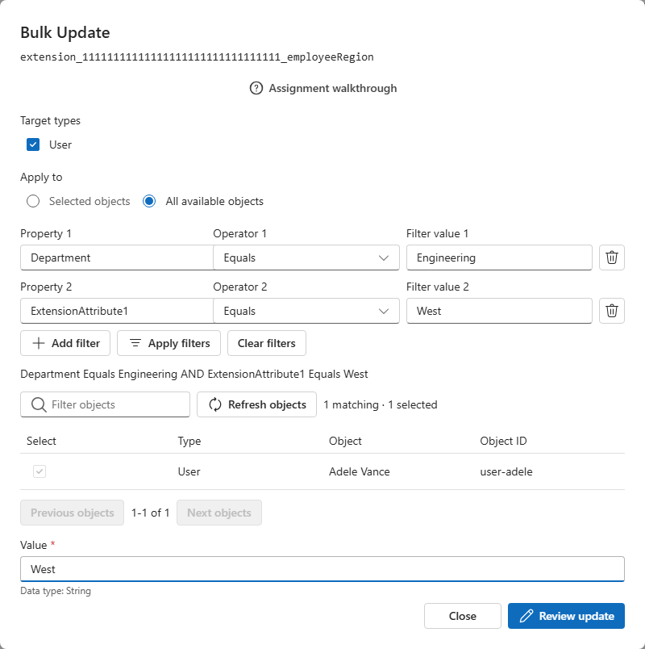

# Assignment Wizard and Walkthrough

This guide covers the assignment, filtering, and walkthrough enhancements in
**v1.1.0**, a non-breaking minor release. Existing directory single-object
assignment remains available alongside the new bulk workflow.

## Contextual Tour

Choose **Help (?)** in the top bar. The walkthrough always starts with **Quick
tour**, then explains navigation and Read/Edit mode before page-specific tasks.
It no longer starts introducing the tour at step 4.

The Directory Extensions page has this sequence:

1. Quick tour
2. Browse & manage extensions
3. Read & Edit modes
4. Directory extensions
5. Assign a value to a single object
6. Bulk assign or update values
7. Switch tenants
8. Make it yours
9. Light or dark
10. Your session

The Schema Extensions page includes its Filter & search step before assignment,
so its contextual tour has eleven steps. Both assignment scenarios remain next
to each other. Other pages without registered steps use the shared seven-step
tour. Next and Back navigate, Finish returns focus to Help, and Skip/Esc exits.
Tours only explain actions; they never change mode, assign values, or execute
bulk writes. Write-mode controls appear after switching to Edit mode separately.

Step 5 spotlights only the **Assign Value to an Object** arrow. Step 6 spotlights
only the adjacent **Bulk Assign/Update** button, not the whole action group.

## Single-Object Assignment

In Edit mode, an extension row presents an assignment arrow directly beside
**Bulk Assign/Update**.

1. Choose the arrow, labeled **Assign Value to an Object** in its tooltip.
2. For a Directory Extension, keep the existing flow: choose the target type,
   search by name/UPN or paste the ID, select the object, and enter a typed value.
3. Choose **Assign**. Successful writes show the existing best-effort read-back.
4. For a Schema Extension, select a target type and exactly one object, enter
   JSON such as `{"courseId":42,"courseName":"Security training"}`, then choose
   **Review update** and **Confirm update**. Selecting another object replaces
   the previous selection; this mode has no all-objects option.

## Bulk Assignment

1. Choose the adjacent **Bulk Assign/Update** button. The existing **Bulk Update**
   menu entry opens the same dialog for backward compatibility.
2. Choose one or more declared target types. Check individual matching objects
   with **Selected objects**, or choose **All available objects**.
3. Add conditions such as Department Equals `Engineering` AND
   ExtensionAttribute1 Equals `West`, then choose **Apply filters**.
4. Select matching objects after applying conditions, or keep the all-objects
   option to include the entire matching population across every Graph page.
5. Enter the value, review the refreshed count, target types, and conditions,
   then confirm. Progress and per-object results appear as writes complete.

For multiple target types, choose an extension declared on those types and use
applicable filters. A user-only Department condition excludes non-user objects;
it does not treat their missing department as a match. Quick search only affects
visible rows. Applied property conditions restrict actual write targets.

## In-Dialog Walkthrough

Choose **Assignment walkthrough** before reviewing a write. It explains:

1. Assign a value to a single object
2. Bulk assign or update values
3. Narrow the target set
4. Review before writing

Finishing or skipping returns to the unchanged assignment dialog. Nothing is
written by the walkthrough. See the [Bulk Update guide](bulk-update.md) for the
property matrix, operators, membership semantics, demo GUIDs, and large-tenant
considerations.